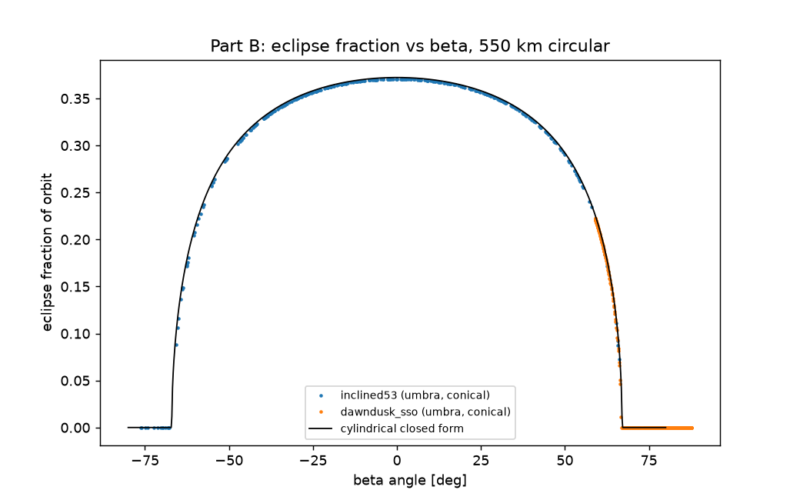
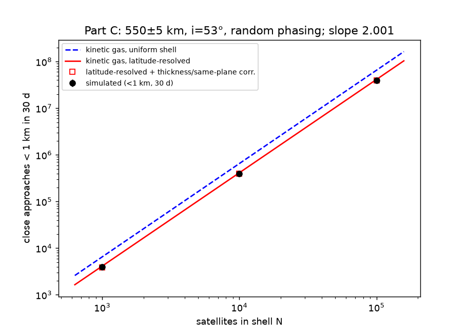

# A Cartesian orbit propagator at 550 km: precession, eclipses, shell conjunctions and avoidance cost

Research question: Oriphim held-out test set. Computation, analysis and drafting: Ori (Oriphim), with an independent review.

## Abstract

We built a Cartesian orbit propagator (8th-order Dormand–Prince integrator, DOP853) with Earth's J2 and J3 gravity terms, atmospheric drag and solar radiation pressure, and applied it to satellites at 550 km altitude. In a two-body test it stays within 0.00012 km of the exact Kepler solution after 30 days. For a 53° orbit with area-to-mass ratio 0.02 m²/kg the orbit plane turns at -4.496 °/day, the mean semi-major axis changes by -59.9 m/day in a static mean atmosphere, and the sun-synchronous inclination is 97.594°. Over 2026 a dawn-dusk sun-synchronous orbit is in eclipse on only 102 days. For randomly phased shells of 10³–10⁵ satellites, the number of approaches closer than 1 km in 30 days grows as N^2.001 and lies within 3 % of a kinetic-gas estimate, but only once that estimate accounts for how a single inclination concentrates satellites near its turning latitudes, for the shell thickness, and for same-plane pairs that never cross; a naive uniform gas overestimates by about 1.6×. The implied avoidance Δv grows approximately in proportion to N and to the cube of the screening threshold.

## 1. Question and why it matters

Large satellite constellations now fill thin shells in low Earth orbit. Three practical questions follow for anyone designing one: how fast the orbit evolves under Earth's oblateness and drag (which sets station-keeping and lifetime), how much time a satellite spends in Earth's shadow (which sets battery and thermal design), and how often satellites in the same shell pass within a kilometre of each other (which sets collision-avoidance workload and fuel). The last is often estimated by treating satellites as molecules of a gas. We test that estimate against a direct simulation, using a propagator whose accuracy we first establish on cases with known answers.

## 2. Method in brief

**Propagator.** The state is position and velocity in an Earth-centred inertial frame, integrated with DOP853 (relative tolerance 10⁻¹²). Forces: two-body gravity; J2 and J3 zonal terms (EGM96 values); drag with a static piecewise-exponential density (Vallado 2013, Table 8-4) and Cd = 2.2; cannonball solar radiation pressure (Cr = 1.5, assumed) with a conical umbra/penumbra shadow.

**Part A.** A 550 km circular orbit at 53°: a two-body Kepler check, a J2-only run against first-order theory, and a 30-day full-force run from which we fit the nodal (orbit-plane) precession, the node-to-node period and the decay rate. The sun-synchronous inclination is found by root-finding on the numerically measured precession.

**Part B.** For a 53° orbit and a dawn-dusk sun-synchronous orbit, the Sun–orbit-plane angle β and the eclipse duration are computed daily through 2026 and compared with the cylindrical-shadow closed form; 7-day full-force runs in two windows (days 0 and 160) cross-check the daily geometry.

**Parts C and D.** Shells of N = 10³, 10⁴, 10⁵ circular satellites at 53°, altitudes uniform in 550 ± 5 km, P = √N evenly spaced planes and random phases, are moved with analytic J2 secular rates (the full propagator is far too slow at this scale). A spatial-hash screener finds every true range minimum below d = 1 km in 30 days; it matches brute-force pair search exactly on small cases. Counts are compared with (i) a uniform kinetic gas and (ii) a latitude-resolved gas, Γ = σ v N² K(sin² i) / (2π³ r² Δh), where σ = πd², K is the complete elliptic integral and Δh = 10 km the shell thickness. The **corrected** gas estimate multiplies (ii) by a finite-thickness factor 1 − 4d/(3πΔh) and a same-plane factor 1 − 1/P (pairs in one plane cannot cross); both are derived, not fitted. Each encounter below a threshold is then charged one along-track burn, one day ahead, sized with the Clohessy–Wiltshire equations to double the miss distance.

## 3. Results

**Propagator accuracy and the 550 km orbit.** The two-body run's period error is 6e-12 (relative) and its energy drift 9e-12. With J2 alone the measured precession, -4.4941 °/day, is within 0.07% of first-order theory. The full-force results are:

| Quantity | Numerical | Analytic |
|---|---|---|
| Nodal precession (°/day) | -4.496 | -4.491 |
| Node-to-node period (s) | 5734.3 | 5735.4 |
| Semi-major-axis change (m/day) | -59.9 | -58.6 |
| Sun-synchronous inclination (°) | 97.594 | 97.593 |

The rough lifetime down to 150 km in the same static atmosphere is 1051 days. If "550 km" is read as the initial osculating radius rather than the mean semi-major axis, the sun-synchronous inclination becomes 97.557°.

**Eclipses.** Eclipse fraction follows the cylindrical closed form (Figure 1), except near grazing β where the conical model differs by up to 0.044 in fraction; eclipses vanish above β ≈ 67°. The 53° orbit sees β swing between -76° and 75° and is eclipsed on 340 of 365 days, with a longest shadow of 35.4 min. The dawn-dusk orbit keeps β between 59° and 88°, so it is eclipsed only around the June solstice (102 days, at most 21.3 min per orbit).



**Conjunctions.** Counts grow as N² (Figure 2) and lie close to the corrected gas estimate. The simulated count is only about 0.61 of the uniform-gas value, mostly because a 53° shell is denser, and its crossings slower, near ±53° latitude.

| N | Encounters < 1 km in 30 d | Corrected gas estimate | Sim / corrected gas | Sim / uniform gas |
|---|---|---|---|---|
| 1,000 | 3,950 | 3,836 | 1.030 | 0.61 |
| 10,000 | 397,772 | 391,985 | 1.015 | 0.61 |
| 100,000 | 39,668,099 | 39,469,096 | 1.005 | 0.61 |



**Avoidance Δv.** Annual Δv per satellite, in m/s (one-day lead time):

| N | 100 m threshold | 200 m | 500 m | 1 km |
|---|---|---|---|---|
| 1,000 | 0.00030 | 0.0029 | 0.052 | 0.39 |
| 10,000 | 0.0042 | 0.032 | 0.49 | 3.8 |
| 100,000 | 0.039 | 0.31 | 4.8 | 37 |

Encounter rate scales roughly with threshold² and each burn with threshold, giving approximately threshold³ (the N = 1,000, 100 m cell rests on only 31 events); doubling the lead time halves the cost. The total is driven by the number of manoeuvres: at N = 10⁵ and 1 km, 4,830 burns per satellite per year, of 7.7 mm/s each on average.

## 4. How it was checked

An independent reviewer (the Sceptic) wrote 29 pass/fail checks before the main run (27 applied in the pilot), recomputing reference values from standard constants rather than from our code: Kepler errors, J2 rates against theory, decay against an independent density calculation, the sun-synchronous inclination, eclipse geometry limits, the gas formulas, an N² slope test, a screening time-step convergence test, and Clohessy–Wiltshire bounds on Δv. Unit tests check J2/J3 against the numerical gradient of the potential and the screener against brute force. The 7-day full-force eclipse cross-check over 420 orbits (two windows only) agrees with the daily geometry to 0.08 min on average (0.27 min at worst).

**What was flagged and changed.** The first full conjunction run counted near-co-moving same-plane pairs at almost every time step (one satellite logged ~149,000 "encounters" at N = 10⁵). The counting rule was changed to accept only true range minima (range rate changes sign within the step, refined by bisection), and Parts C and D were rerun; the per-satellite maximum fell to 1,926. Three check instances then failed: the penumbra-share cap (once per orbit) and the sub-1 km/s share of encounters. Both were over-strict and were revised with stated physics: the penumbra share legitimately grows as the orbit grazes the shadow, and with only 32 planes no cross-plane crossing is slower than about 1.19 km/s. A new check was added that decomposes the small excess over the corrected gas estimate into same-plane drift passes (which the gas model omits) and a slightly wrong same-plane factor (exact form 1 − π/(2KP) instead of 1 − 1/P). With both accounted for, cross-plane counts match the gas within 0.5 % (about one effective standard deviation) at N = 10³ and 10⁴; this was not checked at 10⁵, where the stored event list is truncated. The final review found no suspect results; all 30 final checks pass, including the added decomposition check.

## 5. What this does not show

- **Uncertainties are underestimated.** Nearly half the encounters come from phase-locked pairs that meet repeatedly (up to 905 times in 30 days), an artefact of unperturbed circular orbits. Poisson errors are lower bounds; the effective variance is 3–7× larger.
- **The shell is idealised.** Part C uses analytic circular J2-secular orbits with no drag, eccentricity or short-period terms (which in reality move the radius by about ±10 km, as wide as the shell). Random phasing models an uncoordinated shell, not a designed constellation, which can avoid most such encounters. The same-plane drift events depend entirely on the assumed altitude scatter within each plane. One random seed, one 30-day window.
- **The Δv is a scaling estimate, not a budget.** Avoidance burn only: no return burn (roughly doubling cost), no re-screening, no collision-probability screening, and every repeat encounter is charged. The burden is very uneven between satellites (N = 10⁴: mean 80 versus maximum 986 events per satellite in 30 days). At N = 10⁵ and 1 km the implied ~13 manoeuvres per day are operationally meaningless.
- **Decay and lifetime hold for a mean atmosphere only.** The static density model has no solar cycle; at 550 km density varies about tenfold, and 2026 is near solar maximum, when decay would be faster.
- **Assumed inputs.** The 53° inclination, Cr = 1.5 and an attitude-averaged (cannonball) area are assumptions; drag and SRP scale with the true mean area. Gravity is J2 and J3 only; precession and nutation are ignored. The sun-synchronous inclination depends on whether 550 km means a mean or an osculating radius.

The full list is in LIMITS.md.

## 6. Reproducing it

```
uv venv .venv && uv pip install --python .venv/bin/python -e '.[test]'
.venv/bin/python run.py            # everything, ~1-2 h (Part C at N = 1e5 dominates)
.venv/bin/python run.py --parts AB # Parts A and B only, ~10 s
.venv/bin/python -m pytest -q tests
```

The random seed is fixed (seed = 1). Results-table and headline numbers are filled from `results/` at build time; the few figures quoted from the review history (e.g. the ~149,000-encounter bug, 905 repeat meetings, 3–7× variance) come from notes/review.md and LIMITS.md. The agreed plan is in PLAN.md.
